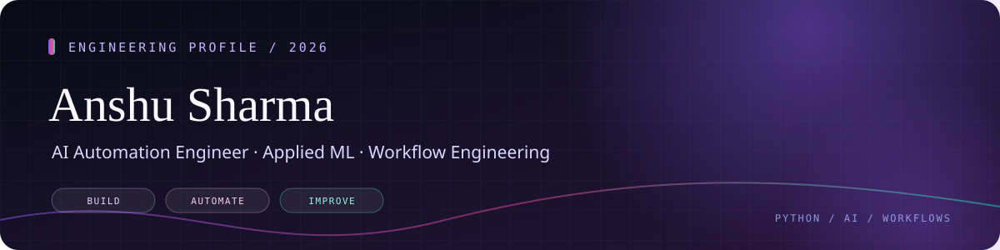

<!--
  ANSHU SHARMA · GitHub Profile README
  Visual assets live in /assets/readme/.
-->

  

  
  
  
  

  

---

I’m an **AI Automation Engineer** working at the intersection of business-process automation, backend integration, document intelligence, and applied machine learning.

I enjoy turning repetitive operations into dependable workflows: understanding the process, connecting systems, validating data, handling exceptions, and making the outcome easier to maintain. My work includes browser automation, API-driven workflows, OCR pipelines, database integration, and ML experimentation.

\`\`\`python
anshu = {
    "role": "AI Automation Engineer",
    "focus": ["Workflow automation", "OCR & document intelligence", "Applied ML"],
    "tools": ["Python", "FastAPI", "n8n", "Selenium", "SQL"],
    "principle": "Automate carefully. Validate inputs. Design for failure."
}
\`\`\`

<table>
  <tr>
    <td width="50%" valign="top">
      <h3>⚙️ Workflow & RPA Automation</h3>
      Browser automation, repeatable operational processes, API/webhook integrations, database updates, and exception handling.
    </td>
    <td width="50%" valign="top">
      <h3>🔎 OCR & Document Intelligence</h3>
      PDF/image preprocessing, structured field extraction, normalization, CSV output, and handling documents that fail validation.
    </td>
  </tr>
  <tr>
    <td width="50%" valign="top">
      <h3>🧠 Applied Machine Learning</h3>
      Data preparation, feature engineering, regression/classification workflows, forecasting, and model evaluation.
    </td>
    <td width="50%" valign="top">
      <h3>🔌 APIs & Data Integration</h3>
      FastAPI services, SQL databases, webhook-driven workflows, and automation orchestration with n8n.
    </td>
  </tr>
</table>

### 🔁 AI Automation Assignment — n8n + Python + SQLite
A workflow-integration project combining n8n, a Python API, webhook requests, and SQLite-backed processing. It explores request validation, duplicate-aware processing, and connecting automation steps into a testable workflow.

### 🧾 OCR Release Order Scanner
A document-processing workflow designed to extract structured fields from varied Release Order PDFs and images, normalize the results, and produce consistent tabular output. The focus areas are OCR quality, folder watching, validation, and error handling.

### ⚡ Retainer RO Ad-Booking Automation
A browser and database automation workflow using Selenium and Oracle DB to reduce repetitive booking steps, update records, and handle common workflow exceptions.

### 📈 Energy Consumption Forecasting
An applied machine-learning pipeline exploring time-series features and regression models, including Random Forest and XGBoost, with an API-based serving workflow.

### 🩺 InsuScan Pro — Medical Report Analysis Prototype
A learning project combining Streamlit, FastAPI, document parsing, and ML-assisted diabetes-prediction experiments. It explores turning extracted information into a more understandable summary.

### 📊 Stock Market Screening & Analysis
A quantitative research project exploring market-data ingestion, technical indicators, liquidity filters, crossover analysis, time-series features, and historical backtesting.

> Some work is private, internal, or still evolving. These summaries avoid proprietary implementation details and do not represent unfinished ML components as production-ready. Browse the [public repositories](https://github.com/SharmAnshu5?tab=repositories) for available source code.

**Languages & data**

  
  
  
  

**Automation & integration**

  
  
  
  
  

**ML, OCR & applications**

  
  
  
  
  

**Databases & developer tools**

  
  
  
  
  

  
  

  
  
  
  

